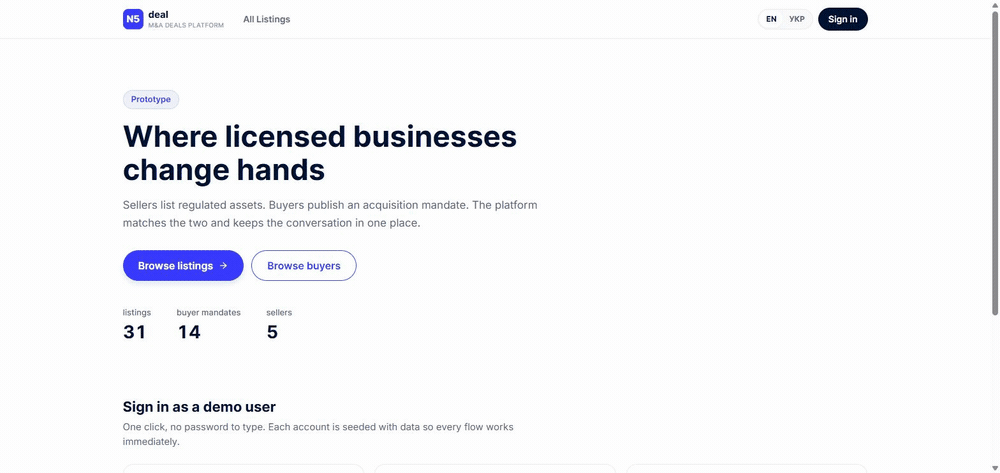

[English](README.md) | **Українська**

# N5Deal: прототип маркетплейсу

Маркетплейс, де переходять із рук у руки регульовані бізнеси й ліцензії. Продавці
виставляють активи, покупці публікують мандат на придбання, менеджер платформи
модерує і те, і те.

**Живе демо:** https://n5deal-marketplace-beige.vercel.app
**Стек:** Next.js 15 (App Router) · TypeScript strict · Postgres + Prisma · Auth.js v5 · Tailwind 4 · next-intl · Gemini



Один клік у роль покупця, мандат зі збігом 100% разом із причинами, з яких склалась
оцінка, і речення _«anything in Ireland or Malta under 4 million»_, перетворене на
справжні фасети в URL. Записано на задеплоєній збірці.

---

## Запуск

Потрібні Node 20.11+ і база Postgres. Проєкт будувався на [Neon](https://neon.tech):
безкоштовний тариф, без картки.

```bash
git clone https://github.com/LeonidShamarin/n5deal-marketplace.git
cd n5deal-marketplace
npm install

cp .env.example .env        # далі заповнити DATABASE_URL, DIRECT_URL і AUTH_SECRET
npx prisma migrate deploy   # або `npm run db:migrate` для dev-бази
npm run db:seed

npm run dev                 # http://localhost:3000
```

`AUTH_SECRET` можна згенерувати так:

```bash
node -e "console.log(require('crypto').randomBytes(32).toString('base64'))"
```

**Застосунок повністю працює без ключа AI.** `GEMINI_API_KEY` необов'язковий; під
кожною AI-функцією є детермінований шлях. Див. [AI](#ai-три-функції-жодна-не-несуча).

Інші команди: `npm test` · `npm run test:e2e` · `npm run typecheck` · `npm run build` · `npm run db:studio`

### Демо-акаунти

На головній сторінці є кнопка входу в один клік для кожної ролі, пароль вводити не треба.

| Роль              | Email                 | Пароль     |
| ----------------- | --------------------- | ---------- |
| Продавець         | `seller@n5deal.demo`  | `demo1234` |
| Покупець          | `buyer@n5deal.demo`   | `demo1234` |
| Менеджер платформи | `manager@n5deal.demo` | `demo1234` |

Спільний опублікований пароль це рішення для середовища рев'ю, а не для проду. Він
потрібен, щоб кожен, хто відкриє посилання на деплой, за секунду опинився в кожній ролі.

---

## Рішення, що визначило все інше

**Покупець і продавець симетричні.** Продавець шукає покупців; покупець шукає активи.
Якщо читати це як дві функції, виходять два каталоги, два рушії фільтрів, два набори
компонентів. Якщо як одну, це один рушій із двома типами карток.

Тож `Asset` і `BuyerProfile` описані **тим самим словником атрибутів**: сектор, тип
ліцензії, юрисдикція за ISO, розмір угоди, визначені один раз у
[`src/lib/vocabulary.ts`](src/lib/vocabulary.ts). Актив каже _«я EMI в Литві за EUR
2M»_; мандат каже _«хочу EMI в Литві приблизно за EUR 1-6M»_. З цього безкоштовно
випливають три речі:

- один рушій фільтрації ([`src/lib/filters.ts`](src/lib/filters.ts)) обслуговує обидва каталоги;
- інтерфейс фасетів, поле пошуку й пагінація це ті самі компоненти;
- **зіставлення стає порівнянням однакового з однаковим**, тож функція оцінки це
  двадцять рядків арифметики, а не евристика.

Новий тип ліцензії означає правку одного файлу. Кожна мапа підписів типізована як
`Record<Enum, string>`, тож розширити enum у Prisma, не додавши підпис, це помилка
компіляції, а не `undefined` у проді.

---

## Архітектура

### Стан живе в URL

Кожен фільтр, пошуковий запит, сортування і номер сторінки читаються з
`searchParams` і пишуться назад в URL. Нічого про список результатів не живе в
стані React. Одне рішення, три вимоги:

- **«стан зберігається після оновлення»**: перезавантаження заново читає URL. Це
  серверний стан, а не трюк із `localStorage`;
- відфільтрований вигляд це **посилання, яким можна поділитись**, а кнопка «назад»
  проходить зміни фільтрів так, як людина й очікує;
- фільтрація працює **в Postgres**, а не в браузері над надмірно завантаженим списком.

Перемикач мови з тієї ж причини зберігає рядок запиту: перехід на українську лишає
ваші фільтри, а не скидає сторінку.

Парсер навмисно поблажливий в один бік і суворий в інший. Відредагований руками
`?category=paymnets` відкидає невідоме значення і показує решту; переплутаний діапазон
цін міняється місцями, а не повертає порожнечу; `?page=1e9` обрізається до стелі, тож
Postgres ніколи не бачить абсурдного зсуву. Ніщо поза словником не потрапляє в запит.

### Авторизація на сервері, і це не кнопки

Сховати елемент це представлення. [`src/lib/session.ts`](src/lib/session.ts) це
примус: кожна сторінка і кожна server action, що торкається непублічних даних,
починається з нього, тож URL, набраний руками, дає ту саму відповідь, що й клік.

Сторінки використовують `forbidden()` / `unauthorized()` з auth-interrupts API
Next, які повертають **справжні HTTP-статуси**, а не редирект, що вдає, ніби сторінки
не було. Заміряно під обліковкою покупця:

| Запит                         | Статус  |
| ----------------------------- | ------- |
| `/en/moderation/participants` | **403** |
| `/en/dashboard/listings/new`  | **403** |
| `/en/assets/999999`           | **404** |
| `/en/inbox` (свій)            | **200** |

Server actions не можуть перервати навігацію, тож для них паралельний шлях:
`withAction()` перетворює провал перевірки на типізований результат, який форма
показує на місці, а власні помилки керування потоком Next кидає далі недоторканими,
а не ковтає.

JWT довіряється тільки щодо особи. Роль і статус акаунта перечитуються з бази на
кожному захищеному запиті, бо менеджер може заблокувати когось, хто вже ввійшов, а
токен відкликати не можна. Заблокований учасник втрачає доступ на **наступному
запиті**, а не при наступному вході.

Власність теж перечитується завжди. Правка прихованого `assetId` у формі дає відмову,
рівноцінну 403, а не чужий лістинг.

### Нічого не видаляється

Учасники й лістинги мають статуси життєвого циклу. «Видалити або заблокувати» з
брифу це питання про життєвий цикл, а відповідь на нього через `DELETE` викинула б
можливість виправити помилку, розмови, прив'язані до рядка, і будь-який шанс на
аудиторський слід.

```
User.status    ACTIVE → SUSPENDED (зворотно) → REMOVED (остаточно)
Asset.status   DRAFT · PUBLISHED · SUSPENDED · SOLD · ARCHIVED
```

**Блокування продавця взагалі не чіпає його лістинги.** Публічний каталог ховає їх
через join за статусом продавця:

```ts
const PUBLIC_ASSET_WHERE = { status: "PUBLISHED", seller: { status: "ACTIVE" } };
```

Саме тому розблокування повертає _точно_ попередній стан, а не здогадку. Перевірено в
базі, а не задекларовано, на розблокуванні заблокованого продавця з сид-даних:

|                  | до                        | після                         |
| ---------------- | ------------------------- | ----------------------------- |
| Статус продавця  | `SUSPENDED`               | `ACTIVE`                      |
| Його лістинги    | 1 `DRAFT`, 2 `PUBLISHED`  | **1 `DRAFT`, 2 `PUBLISHED`**  |
| Публічний каталог | 31                       | **33**                        |

Чернетка лишилась чернеткою. Блокування _окремого лістингу_ змінює рядок, тож воно
спершу записує `previousStatus` і повертає його при розблокуванні, а коли нічого не
записано, відкочується на `DRAFT`, ніколи не на `PUBLISHED`, бо випадкова повторна
публікація гірша за випадкове зняття.

Кожна дія модерації вимагає причини щонайменше з десяти символів і пише
`ModerationEvent` у **тій самій транзакції**, що й зміна статусу: журнал аудиту з
дірами гірший, ніж жодного. Видалення просить друге явне підтвердження, бо це єдина
дія тут, яку не можна скасувати.

### Гроші

Цілі мінорні одиниці плюс enum валюти. Жодних float поблизу ціни.

Колонка має тип `BigInt`, і це було виправлення: `Int` це Postgres `INT4`, що впирається
в 2.1 мільярда мінорних одиниць, тобто **EUR 21.47M**, а банківська ліцензія легко
більша. Сид упав саме на цьому, і це корисний вид падіння. Зберігання в основних
одиницях лишило б `Int`, ціною тієї точності, заради якої мінорні одиниці й обрали.

### Дедуплікація розмов

Повторне звернення до того самого продавця щодо того самого лістингу має відкривати
наявну розмову. Очевидне `@@unique([assetId, buyerId, sellerId])` цього не робить:
Postgres вважає NULL різними, тож дві «загальні» розмови між тією самою парою обидві
були б дозволені. Натомість розмова має один непорожній `key`
(`"<assetId|general>:<buyerId>:<sellerId>"`), а запис це `upsert`, тож два кліки
навипередки не створять два рядки.

---

## AI: три функції, жодна не несуча

У всіх трьох та сама форма: **рішення за правилами, модель радить.** Кожна функція
працює без API-ключа, і інтерфейс каже, який шар відповів, а не лишає вгадувати.

| Функція                     | Детермінований шар                                                                                                   | Що додає модель                                                    |
| --------------------------- | -------------------------------------------------------------------------------------------------------------------- | ------------------------------------------------------------------ |
| Пошук природною мовою       | [`nl-query.ts`](src/lib/nl-query.ts) витягає з речення сектори, юрисдикції, типи ліцензій і межі ціни                 | Розширює те, чого правила знати не можуть: _«the Baltics»_ → LT, LV, EE |
| Рев'ю лістингу              | [`listing-review.ts`](src/lib/listing-review.ts) знаходить суперечності, які можна перевірити                         | До трьох порад, завжди підказки, ніколи не вето на публікацію       |
| Зіставлення покупця й активу | [`matching.ts`](src/lib/matching.ts) оцінює п'ять зважених чинників                                                  | Перетворює чинники на речення                                       |

Три правила примушуються в [`src/server/ai/gemini.ts`](src/server/ai/gemini.ts), а не
в кожному місці виклику:

1. **Ключ необов'язковий.** Немає ключа, немає падіння: натомість працює детермінований шлях.
2. **Модель пропонує, zod вирішує.** Одна zod-схема дає і JSON schema, що йде в модель,
   _і_ валідує те, що повертається, тож вигаданий код країни відкидається до того, як
   потрапить у запит.
3. **Обмеженість.** Одна спроба, `AbortSignal.timeout` на 8 секунд, без циклу повторів.
   Повільна модель погіршує функцію, але ніколи не вішає сторінку.

### Вибір моделі, заміряно

Той самий промпт, по два прогони:

| Модель                      | Затримка        | Результат                                  |
| --------------------------- | --------------- | ------------------------------------------ |
| **`gemini-3.1-flash-lite`** | **0.7s / 1.4s** | правильно, **обрано**                      |
| `gemini-3-flash-preview`    | 2.0s / 2.1s     | правильно, але назва preview               |
| `gemini-flash-lite-latest`  | 1.7s / 2.7s     | загорнула об'єкт у масив                   |
| `gemini-3.6-flash`          | 22.4s / 27.3s   | правильно, і непридатно для поля пошуку    |

Усі чотири витягли однакові фільтри, включно з розгортанням _«the Baltics»_ у
LT/LV/EE, тож вирішила затримка. `thinkingLevel: "LOW"` не допоміг 3.6-flash (22.9s),
а `thinkingBudget: 0` вона просто відхиляє. Закріплено точну версію, а не плаваючий
псевдонім `-latest`, щоб ротація моделей не змінила поведінку застосунку після здачі.

(`gemini-2.5-flash` був першим вибором, але для нещодавно створених API-ключів він
закритий: API відповідає 404, _«no longer available to new users»_.)

### Що насправді дала модель

На рев'ю навмисно зламаної чернетки (ліцензія EMI в Сінгапурі, діючий бізнес, нуль
працівників) правила дали помилку й попередження. Модель додала те, чого правила
закодувати не могли:

> Specify the exact MAS (Monetary Authority of Singapore) licence type held, as
> Singapore does not use the term 'EMI' but rather 'Major Payment Institution' or
> 'Standard Payment Institution'.

Тобто: вкажіть точний тип ліцензії MAS, бо в Сінгапурі немає терміна «EMI», є «Major
Payment Institution» або «Standard Payment Institution». Це і є той розподіл праці, на
який розрахований дизайн.

---

## Крайні випадки

Кожен із них пройдено в браузері, а не обміркувано:

- Блокування продавця ховає його лістинги; розблокування повертає кожен статус недоторканим (31 → 33 → 31).
- Лістинг видаленого продавця показує сторінку **«знято разом із власником»**, а не 404, що заперечує його існування, і не 500 від напівзавантаженого зв'язку.
- Повторне звернення до того самого продавця щодо того самого лістингу потрапляє в **ту саму розмову**, обидва повідомлення по порядку.
- Заблокованому чи видаленому учаснику не можна написати, а в наявних розмовах замість поля вводу банер «тільки читання».
- Менеджери не можуть модерувати себе чи одне одного; продавці не можуть редагувати лістинг, який заблокував менеджер.
- Прихований мандат покупця **не знаходиться** для того, хто не має на нього права, включно з тим, хто набере id руками: видимість усередині запиту, а не застосовується потім.
- Відвідувачі без входу взагалі не бачать каталогу покупців: хто що купує і з яким бюджетом, не публічна інформація.
- Кожен список має порожній стан із виходом із нього.

---

## Тестування

`npm test`: **65 юніт-тестів**, без бази, ~1.4 с.
`npm run test:e2e`: **7 наскрізних сценаріїв** у Playwright, ~1.6 хвилини.

Вони покривають чисті функції, де помилка дорога й непомітна: розбір грошей з
роздільниками, які люди справді вставляють, розбір фільтрів з URL як межа довіри,
оцінка зіставлення, детермінований NL-парсер, правила рев'ю лістингу і ключ розмови.

Три впали на першому прогоні, і всі три були варті того:

- **Справжній баг.** _«is **it** an operating business»_ вибирало Італію. Голі
  дволітерні коди зіставлялись без урахування регістру, а IT, AT, BE, IN, IS і US це
  звичайні англійські слова. Тепер коди приймаються тільки великими літерами; назви
  країн лишаються нечутливими до регістру.
- **Мертвий код.** Правило про дату в майбутньому в рев'юері лістингів було
  недосяжне: схема відхиляє рік раніше, а рев'юер працює тільки на вході, що пройшов
  схему. Видалено, а не лишено як запобіжник, що не може спрацювати.
- **Хибне очікування.** `?page=1e9` обрізається до стелі сторінок, а не падає на першу
  сторінку. Помилявся тест, а не код.

Раннер навмисно обмежений (два воркери, 5 с на тест, ліміт heap на прогін), тож тест,
що понісся, падає, а не тягне за собою редактор.

### Наскрізні тести

`npm run test:e2e` запускає сім сценаріїв у Playwright: один основний шлях на роль
плюс крайні випадки, яких рев'ю скріншотів ніколи б не зловило.

Перше налаштування:

```bash
cp .env.test.example .env.test   # направити на ІНШУ базу, ніж у .env
npm run db:create:test           # створює n5deal_test у тому самому проєкті Neon
npm run db:migrate:test
npx playwright install chromium
npm run test:e2e
```

Два рішення визначають набір:

- **У нього власна база.** Сценарій менеджера блокує продавця і міняє статуси
  лістингів. Спрямований на базу за задеплоєним демо, він лишив би рев'юера перед
  заблокованим учасником і половиною каталогу. `.env.test` дивиться на окрему базу, а
  `globalSetup` перезасіває її перед кожним прогоном, тож кожен прогін починається з
  відомого стану, і провалений прогін не може отруїти наступний. Ізоляцію перевірено, а
  не припущено: після повного прогону демо-база все ще показувала 42 активи, нуль
  тестових лістингів і нуль тестових рядків аудиту.
- **Він працює проти продакшн-збірки**, а не `next dev`. Вони відрізняються
  рендерингом і обробкою помилок, і цей проєкт уже дав одну знахідку, яка з'явилась
  тільки у зібраному виводі.

Набір також навмисно працює **без `GEMINI_API_KEY`**. Під кожною AI-функцією є
детермінований шлях, і ці тести проганяють саме його, тож зелений прогін це ще й доказ,
що застосунок працює без доступної моделі.

Що сценарії реально перевіряють:

| Роль     | Сценарій                                                                                                                         |
| -------- | -------------------------------------------------------------------------------------------------------------------------------- |
| Покупець | Входить, бачить підібрані лістинги **з причинами, які дав оцінювач**, відкриває один, пише продавцю, знаходить розмову у вхідних |
| Покупець | Повторне звернення щодо того самого лістингу потрапляє в **ту саму розмову**, а не в дубль                                       |
| Продавець | Створює чернетку, переконується, що її **немає в публічному каталозі**, публікує, знаходить її там                               |
| Продавець | URL редагування чужого продавця відповідає **403**                                                                               |
| Менеджер | Блокує продавця → каталог зменшується → розблоковує → **кількість повертається точно**, обидві дії в журналі аудиту              |
| Менеджер | Заблокованому учаснику відмовлено при вході                                                                                       |
| Менеджер | Модерація відповідає покупцю **403**                                                                                              |

Тест каскаду менеджера варто прочитати. Він рахує публічний каталог очима відвідувача
до, під час і після, і перевіряє, що число повертається рівно до попереднього, а це
тримається тільки тому, що блокування ніколи не пише в лістинги.

---

## Припущення

Що бриф лишив відкритим, вирішено, а не відкладено:

- **«Контакт» означає розмову на платформі**, а не інтеграцію з поштою. Угоди тут починаються з питань під NDA; вести це через пошту означало б вивести платформу за межі її власної угоди.
- **Верифікація це значок від платформи, а не KYC-процес.** Продавці мають прапорець `verified`, який ставить менеджер. Справжній онбординг це проєкт, а не функція.
- **Механіка угод поза межами**: без escrow, без комісії, без пропозиції й контрпропозиції. Прототип доводить дві сторони до моменту розмови.
- **Покупець бачить тільки свій мандат** у каталозі покупців. Список конкурентів був би іншим продуктом.
- **Менеджери модерують, а не торгують.** У них немає мандата, і вони не з'являються в жодній розмові.
- **Один мандат на покупця.** Кілька паралельних мандатів на цьому ринку буває, і це одна зміна схеми, але вони ускладнюють зіставлення, нічого нового не показуючи.
- **Ціни у валюті лістингу без конвертації.** Фільтр в EUR порівнюється з лістингом у USD чисельно. Чесний обмін валют потребує джерела курсу і правила, який курс брати.

---

## Межі, які я провів свідомо

- **Next.js 15.5, а не 16.** Next 16 вийшов під час розробки; Auth.js v5, next-intl і Prisma місяцями працюють проти 15.x, а 24-годинна розробка це не те місце, де варто відкривати діри в екосистемі.
- **Предметна таксономія лишається англійською в обох локалях.** Інтерфейс перекладений повністю: навігація, форми, фасети, порожні стани, множина, формат чисел і валют. Назви секторів і ліцензій ні, бо так цей ринок називає їх і в українських текстах: EMI, VASP, MSO, Fintech. Якщо це рішення хибне, переклад це один `Record<Locale, Record<Enum, string>>`.
- **Юрисдикції показуються кодами ISO, а не прапорами.** Емодзі прапорів були першою спробою, і від них довелось відмовитись: Windows не має гліфів для блоку regional indicator, тож Chrome там показує прапор голими літерами, і це виглядає зламаним саме на тій машині, якою найімовірніше користуватиметься рев'юер. Альтернативи: CDN картинок (зовнішня залежність заради декору) або ~30 вбудованих SVG.
- **Пошук через `ILIKE`, а не повнотекстовий.** Він працює в базі і чесний щодо того, що робить. `pg_trgm` це наступний крок, а не переписування.
- **Зіставлення рахується в пам'яті** над обмеженим набором кандидатів. Оцінка має часткові бали біля меж; вираз цього в SQL або сплющив би його в грубий булів фільтр, або став би непідтримуваним. На десятках лістингів чесна версія ще й швидка.

---

## Використані AI-інструменти

Зроблено з **Claude Code** (Opus) у парі, за письмовим планом, який я склав спершу:
архітектура, модель даних, обрізання обсягу і порядок роботи були вирішені до будь-якого
коду, і коміти йдуть за планом.

Конкретно це означало: я обрав симетричну модель покупця й активу, правило «URL як
стан», життєвий цикл із м'яким видаленням і поділ «рішення за правилами, модель
радить»; Claude написав більшу частину реалізації під ці рішення, а я перевіряв кожен
сценарій у браузері, щойно він з'являвся. Кілька виправлень з історії комітів
(переповнення `INT4`, рендер прапорів на Windows, залишок «Baltics», що спустошував
власний набір результатів, нечутливі до регістру коди країн) вийшли саме з цієї
перевірки, а не з рев'ю.

**Gemini** (`gemini-3.1-flash-lite`) це модель, яку кличе сам продукт, обрана за
замірами вище.

---

## Що я зробив би далі

У тому порядку, в якому справді робив би:

1. **Повнотекстовий пошук** на `pg_trgm` або Meilisearch, з підрахунком фасетів одним агрегатним запитом замість одного на кожне завантаження сторінки.
2. **Сповіщення.** Приходить повідомлення, і ніхто про це не знає. Таблиця outbox плюс воркер, а не виклик пошти в коді запиту.
3. **Оптимістичні оновлення** в елементах модерації й статусів: зараз кожна дія чекає відповіді сервера.
4. **Шар дозволів на політиках.** Перевірки явні й читабельні, але це `if`; ще на десятку комбінацій ролей і ресурсів їм краще бути даними.
5. **Кілька мандатів на покупця** і збережені пошуки зі сповіщеннями: природне наступне прохання справжнього покупця.
6. **Rate limiting на AI-ендпоінтах.** Вони за перевіркою сесії й обмежені на виклик, але ніщо не заважає користувачу, що ввійшов, кликати їх у циклі.

---

## Відомі обмеження

Сказано прямо, а не сховано:

- **Лістинг видаленого продавця повертає HTTP 200** зі сторінкою-поясненням. App Router не має підтримуваного способу задати довільний статус зі сторінки; 401 і 403 використовують примітиви auth-interrupts, а буквальний 410 вимагав би перенести сторінку за route handler.
- **`npm audit` показує попередження високої серйозності** в транзитивних залежностях часу збірки (`postcss`, `sharp`, `deepmerge-ts`). Жодне не досяжне з коду застосунку під час роботи, а `audit fix --force` понизив би мажорні версії Next і Prisma.
- **Метадані сторінок не локалізовані**: `<title>` англійською на українських сторінках.
- **Списки модерації обрізані на 25 рядках** без пагінації. Каталоги пагінуються як слід; вигляди модерації розраховані на сид-дані.
- **Лічильник переглядів збільшується на кожен рендер**, тож оновлення сторінки рахується. Дедуплікація потребує відбитка глядача і вікна.
